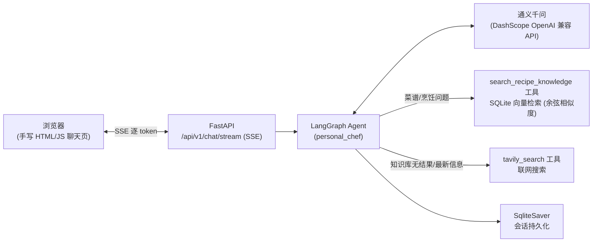

# lc-course · 私人厨师 Agent

基于 **LangGraph** 的菜谱 Agent：通过网页进行多轮流式对话，优先检索带来源引用的本地菜谱知识库（RAG），知识库没有答案时自动调用 Tavily 联网搜索补充。

## 项目亮点

- **LangGraph Agent**：使用 `create_agent` 构建具备工具调用能力的 Agent，由模型自主决策何时检索、何时联网
- **RAG 检索增强**：自实现的文本切分 + Embeddings + SQLite 余弦相似度检索，回答强制携带 `[来源: ...]` 引用，防止模型伪造出处
- **SSE 流式输出**：FastAPI `StreamingResponse` 逐 token 推送，前端原生 `fetch` + `ReadableStream` 解析 SSE 帧
- **会话持久化**：LangGraph `SqliteSaver` Checkpointer 按 `thread_id` 隔离多轮对话历史，支持查询与清空
- **工程化**：uv 管理依赖、Pydantic 请求校验、unittest 覆盖核心链路（向量排序、文档替换、SSE 协议、历史接口）

## 架构



文档通过 `POST /api/v1/knowledge/documents` 导入：切分（500 字 / 80 重叠）→ DashScope Embeddings 向量化 → 存入 `resources/recipe_knowledge.db`。检索时把用户问题向量化，按余弦相似度取最相关切片拼进工具返回，Agent 基于切片作答并标注来源。

## 环境要求

- Python 3.13 或更高版本
- [uv](https://docs.astral.sh/uv/)
- 调用模型需要 DashScope API Key；菜谱搜索需要 Tavily API Key
- 知识库导入和检索使用 DashScope OpenAI 兼容 Embeddings API（默认模型 `text-embedding-v4`）
- 使用 OSS 上传签名接口时，需要阿里云 OSS 凭证和 Bucket 配置

## 快速开始

### 1. 安装依赖

```bash
uv sync
```

### 2. 配置环境变量

在项目根目录创建 `.env`，填入所需配置。不要将真实密钥提交到版本库。

```dotenv
DASHSCOPE_API_KEY=你的DashScope密钥
DASHSCOPE_BASE_URL=https://dashscope.aliyuncs.com/compatible-mode/v1
TAVILY_API_KEY=你的Tavily密钥
EMBEDDING_MODEL=text-embedding-v4

# OSS 签名接口所需；访问密钥使用阿里云 SDK 支持的环境变量名
OSS_ACCESS_KEY_ID=你的阿里云AccessKeyId
OSS_ACCESS_KEY_SECRET=你的阿里云AccessKeySecret
OSS_BUCKET=你的Bucket名称
OSS_ENDPOINT=oss-cn-beijing.aliyuncs.com
```

`DASHSCOPE_BASE_URL` 用于聊天模型和 Embeddings；`EMBEDDING_MODEL` 默认为 `text-embedding-v4`。文档向量与会话分别保存在 `resources/recipe_knowledge.db` 和 `resources/personal_chef.db`。`OSS_ENDPOINT` 默认为 `oss-cn-beijing.aliyuncs.com`；OSS 凭证未配置时 OSS 路由不会挂载。

### 3. 导入示例知识库（可选但推荐）

```bash
uv run python scripts/seed_knowledge.py
```

脚本会把 `examples/recipes/` 下的 3 篇示例文档切分、向量化并导入本地知识库。导入后问"番茄炒蛋怎么做"即可看到带来源引用的 RAG 回答；不导入也能聊，Agent 会退化为纯联网搜索。

### 4. 启动服务

```bash
uv run uvicorn main:app --app-dir src --reload --host 127.0.0.1 --port 8001
```

访问 `http://127.0.0.1:8001` 使用聊天界面，或访问 `/docs` 查看 OpenAPI 文档。

### 启动 LangGraph 开发服务（可选）

项目根目录的 `langgraph.json` 将 `chef_agent` 指向 `src/agents/personal_chef.py` 中的 `agent`：

```bash
uv run langgraph dev
```

## API

API 路由前缀为 `/api/v1`：

| 方法 | 路径 | 说明 |
| --- | --- | --- |
| `POST` | `/chat/stream` | SSE 流式多轮对话；事件类型为 `token`、`done` 或 `error`。 |
| `GET` | `/chat/messages?thread_id=...` | 获取指定会话的历史消息。 |
| `DELETE` | `/chat/messages?thread_id=...` | 清空指定会话的历史消息。 |
| `POST` | `/knowledge/documents` | 切分、向量化并导入一篇知识文档；同一 `source` 再次导入会替换旧内容。 |
| `GET` | `/oss/presign?filename=...` | 获取 OSS 上传签名 URL；仅在 OSS 配置可用时挂载。 |

### 导入知识文档

把 `source` 设置为稳定、可读的文档名称或 URL，回答会引用这个值：

```bash
curl -X POST http://127.0.0.1:8001/api/v1/knowledge/documents \
  -H "Content-Type: application/json" \
  -d "{\"source\":\"番茄炒蛋做法.md\",\"content\":\"鸡蛋打散后炒至凝固并盛出。番茄炒软后加入鸡蛋，调味翻炒即可。\"}"
```

导入接口返回切片数量。Agent 会把用户问题向量化，在 SQLite 中按余弦相似度检索最相关的切片；菜谱、食材搭配和烹饪问题优先使用知识库，回答中应包含 `[来源: ...]`。知识库没有相关内容时，Agent 可以调用 Tavily 联网补充。知识库为空时无需先配置 Embeddings；首次导入和检索需要 DashScope API Key。

文档导入 API 当前用于本地演示，公开部署前应为它增加认证和访问控制。

聊天请求示例：

```json
{
  "message": "鸡蛋和番茄怎么做？",
  "image_url": null,
  "thread_id": "demo-session"
}
```

## 项目结构

```text
.
├── langgraph.json             # LangGraph 开发服务配置
├── pyproject.toml             # Python 项目与依赖配置
├── examples/recipes/          # 示例菜谱文档（配合 seed 脚本使用）
├── scripts/
│   └── seed_knowledge.py      # 一键导入示例知识库
└── src/
    ├── main.py                # FastAPI 应用入口
    ├── agents/
    │   └── personal_chef.py   # 带知识库/联网工具的 LangGraph Agent
    ├── api/v1/
    │   ├── chat.py            # 对话及历史记录路由
    │   ├── knowledge.py       # 知识文档导入路由
    │   └── oss.py             # OSS 上传签名路由
    ├── models/schemas.py      # 请求数据模型
    ├── services/
    │   └── knowledge_base.py  # 文本切分、Embeddings 和 SQLite 向量检索
    ├── common/logger.py       # 日志配置
    └── static/                # 手写的聊天前端（index.html / style.css / app.js）
```

本地数据库写入根目录下的 `resources/`。`.env`、`resources/`、`.venv/` 和 LangGraph 本地运行状态均已加入 `.gitignore`。

## 设计取舍

- **用 SQLite 做向量库而不是引入专门的向量数据库**：演示项目数据量小（百级切片），余弦相似度全表扫描足够快，换来零外部服务依赖——clone 下来配好 key 就能跑。数据量大时可平移到 pgvector / Milvus，`KnowledgeStore` 的接口不需要变。
- **自实现切分和相似度而不是用现成框架的 Retriever**：切分（`split_text`）和余弦相似度（`_cosine_similarity`）各不到 20 行，保留对 RAG 核心环节的完整控制，也方便替换成更复杂的策略（按标题切、混合检索等）。
- **导出两套 Agent 实例**：`agent` 不带 Checkpointer，交给 `langgraph dev` 平台托管持久化（LangGraph dev 模式不允许显式配置 Saver）；`local_agent` 带 `SqliteSaver`，供 FastAPI 的历史消息 API 使用。同一份工具和 prompt，两种运行形态。
- **来源引用靠 prompt 约束 + 工具返回格式保证**：工具返回的每个切片都以 `[来源: ...]` 开头，system prompt 要求模型在结论后照抄标记——不依赖模型自觉，测试里也验证了引用格式不被破坏。
- **SSE 而不是 WebSocket**：对话是单向推送（服务端 → 客户端），SSE 用普通 HTTP POST 即可实现，前端无需额外库，协议也更容易在测试里断言。

## 测试

```bash
uv run python -m unittest discover -s tests -v
```

测试使用内存替身验证向量排序、文档替换、SSE 对话响应和历史接口，不需要调用真实模型或搜索服务。
